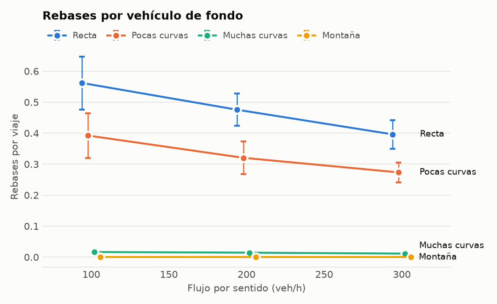
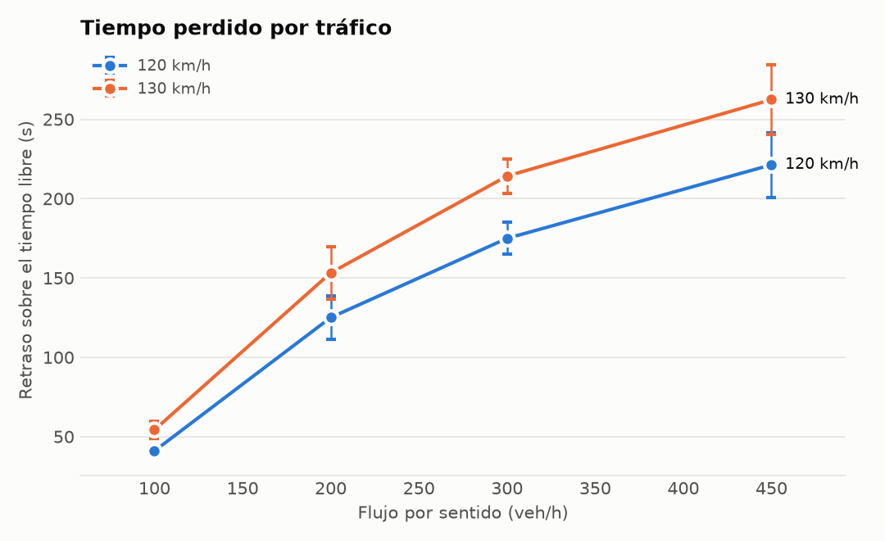

# Simulación de tráfico en carretera de dos carriles

¿Cuánto tiempo se ahorra de verdad al ir más rápido en una carretera de un carril por sentido?

Simulación por pasos de tiempo de una carretera con **un carril por sentido**. Cada vehículo tiene
una **velocidad deseada fija** y busca mantenerla. Si alcanza a uno más lento, frena y lo sigue; solo
puede **rebasar invadiendo el carril contrario** cuando hay un hueco seguro frente al tráfico que viene
de frente y, en curvas, cuando **ve** lo suficiente. Ahí se pierde el tiempo.


## Uso rápido

```bash
trafico                 # menú interactivo (recomendado)
trafico corrida ...     # una simulación con todos los datos y gráficas
trafico animar ...      # animación en vivo (para mostrar en una expo)
trafico campana ...     # muchas simulaciones barriendo parámetros
trafico graficar DIR    # gráficas de una campaña ya corrida
```

`python -m trafico ...` funciona igual. Cada comando acepta `-h` para ver todas sus opciones.

### Menú

`trafico` sin argumentos abre un menú que pregunta paso a paso (Enter acepta el valor por defecto):
corrida única, animación, campaña o graficar. Al final muestra el **comando equivalente**, para poder
repetir exactamente la misma corrida.

### Tráfico: tres formas de definirlo

| Modo | Qué significa | Opciones |
|---|---|---|
| `flujo` | Llegan vehículos al azar (Poisson), tantos por hora y sentido | `--flujo 200` |
| `lleno` | La carretera arranca con N vehículos por sentido y cada uno que sale se repone | `--modo lleno --vehiculos 70` |
| `total` | Entran exactamente N vehículos por sentido y la corrida termina cuando salen todos | `--modo total --vehiculos 200 --flujo 300` |

Velocidades deseadas Normal(`--v-media` 100, `--sigma` 10) km/h truncada a 60-140.
Las **sondas** son vehículos con velocidad deseada fija (`--vel-sonda 130`) que entran a intervalos
regulares y se miden aparte.

### Tipo de carretera

| `--trazado` | Descripción |
|---|---|
| `recta` | Sin curvas (por defecto) |
| `pocas` | 0.3 curvas por km, radio 300-900 m |
| `muchas` | 1.2 curvas por km, radio 150-450 m |
| `montana` | 2.5 curvas por km, radio 60-200 m |

Los trazados se generan al azar: con `--semilla-trazado 0` (por defecto) cada réplica tiene una carretera
distinta del mismo tipo, y con otro número el trazado queda fijo. También se pueden dar curvas a mano
(por ejemplo, de una carretera real): `--param "curves=1500:2500:200;6000:6400:350"` (inicio:fin:radio en m).

### Corrida única

```bash
trafico corrida --flujo 200 --longitud 20000 --vel-sonda 130 --sondas 5 --trazado pocas --salida results/r1
```

Guarda en la carpeta de salida:

- `viajes.csv`: un renglón por vehículo, con su velocidad deseada, tiempo de viaje, tiempo libre, retraso,
  rebases hechos, veces que lo rebasaron, **alcances** (veces que tuvo que frenar por alguien), tiempo lento
  y espera para entrar.
- `eventos.csv`: cada rebase iniciado, completado o abortado (instante y posición).
- `fotos.csv`: posición y velocidad de todos los vehículos cada 5 s (`--fotos`).
- `config.json` (para repetirla) y `resumen.json`.
- Gráficas: diagrama espacio-tiempo, histograma de retrasos, retraso contra velocidad deseada,
  % de vehículos en pelotón y rebases por kilómetro.


### Animación

```bash
pip install -e ".[anim]"   # una vez (instala pygame-ce)
trafico animar --modo lleno --vehiculos 70 --trazado pocas --pantalla-completa
```

Arriba se ve la carretera completa y abajo un tramo ampliado que sigue a la sonda. Colores:
**azul** libre, **gris** atrapado detrás de otro, **verde** rebasando y **naranja** la sonda.
Las curvas aparecen sombreadas con su radio y velocidad máxima, y la línea central es amarilla
continua donde no hay visibilidad para rebasar. Abajo, una tabla muestra cuánto tardó cada sonda
y cuánto perdió por el tráfico.

Controles: `Espacio` pausa, `+`/`-` velocidad (×1 a ×100), rueda o `Z`/`X` zoom, flechas para moverse,
`S` seguir a la sonda, `Tab` otra sonda, clic en el mapa para ir a un punto, `R` reiniciar,
`F11` pantalla completa, `Esc` salir.

### Campañas

```bash
trafico campana --barrer trazado=recta,pocas,muchas --barrer flujo=100,200,300 \
    --velocidades 110 120 130 --semillas 8 --sondas 20 --nucleos 8 --salida results/curvas
trafico graficar results/curvas --x flujo --serie trazado --comparar 120 130
```

- Se puede barrer **cualquier parámetro** (`--barrer nombre=v1,v2,...`, repetible: se combinan todos). Nombres
  cortos: `flujo`, `longitud`, `vehiculos`, `modo`, `trazado`, `sigma`, `v_media`, `despeje`, `a_lateral`, o
  internos como `idm.T` y `overtaking.t_guard`.
- Cada corrida se guarda en cuanto termina: si se corta, el mismo comando **reanuda**. Con más `--semillas`
  o `--velocidades` se amplía una campaña existente sin repetir lo hecho.
- Datos crudos: `corridas.csv` (resumen del tráfico de fondo por corrida), `sondas.csv` (cada sonda) y,
  con `--viajes`, `viajes.csv` (cada vehículo de cada corrida).
- `graficar` genera tablas con media ± IC 95 % y gráficas sin volver a simular.

## Resultados fase 2: tipo de carretera y distancia

### ¿Y si la carretera tiene curvas? (20 km, 8 réplicas, cada una con un trazado distinto)

Tiempo que se gana al ir a 130 en vez de 120 km/h (media ± IC 95 %; entre paréntesis, lo que se ganaría en vía libre):

| Flujo por sentido | Recta | Pocas curvas | Muchas curvas | Montaña |
|---:|---:|---:|---:|---:|
| 100 veh/h | 32.9 ± 4.8 s (46.2) | 26.1 ± 6.8 s (38.0) | 4.4 ± 1.8 s (7.1) | 0.3 ± 0.1 s (0.3) |
| 200 veh/h | 18.0 ± 5.4 s | 12.3 ± 3.6 s | 1.5 ± 1.2 s | 0.2 ± 0.1 s |
| 300 veh/h | 6.9 ± 3.3 s | 6.2 ± 3.8 s | 0.5 ± 0.5 s | 0.2 ± 0.1 s |
| % de la carretera sin visibilidad para rebasar | 0 % | 19 % | 68 % | 93 % |




**Conclusiones**
- **Las curvas quitan la ganancia por dos lados.** Primero, bajan el techo: con muchas curvas casi nunca se llega
  a 120 km/h entre una y otra, así que incluso en vía libre ir a 130 solo ahorra 7 s en 20 km (0.3 s en montaña).
  Segundo, quitan los rebases: a 200 veh/h cada vehículo rebasa en promedio 0.48 veces en recta, 0.32 con pocas
  curvas, 0.01 con muchas y nunca en montaña.
- Con **pocas curvas** suaves la carretera se parece a la recta: se pierde algo de ganancia (12 s frente a 18 s a
  200 veh/h), pero sigue valiendo la pena en tráfico ligero.
- Con **muchas curvas**, ir a 130 en lugar de 120 ahorra 1 o 2 segundos en 20 km: no compensa el riesgo.
- Curioso: con muchas curvas el **tráfico de fondo pierde menos tiempo** (28 s de retraso medio a 200 veh/h,
  frente a 48 s en recta). En las curvas todos van a la misma velocidad, así que importa menos que unos
  quieran ir más rápido que otros.

### ¿Importa la distancia? (carretera recta, 8 réplicas)

| Longitud | 100 veh/h | 200 veh/h | 300 veh/h | Ideal |
|---:|---:|---:|---:|---:|
| 5 km | 7.6 ± 1.1 s | 2.6 ± 1.1 s | 1.3 ± 0.6 s | 11.5 s |
| 10 km | 16.4 ± 2.3 s | 7.7 ± 2.1 s | 3.9 ± 3.5 s | 23.1 s |
| 20 km | 32.9 ± 4.8 s | 18.0 ± 5.4 s | 6.9 ± 3.3 s | 46.2 s |
| 40 km | 66.8 ± 7.9 s | 47.4 ± 5.5 s | 23.0 ± 14.5 s | 92.3 s |


**Conclusiones**
- Con tráfico ligero (100 veh/h) se obtiene ~70 % de la ganancia ideal sin importar la distancia.
- Con tráfico moderado (200 veh/h), **en trayectos largos se aprovecha mejor ir rápido**: 23 % de la ganancia
  ideal en 5 km, 39 % en 20 km y 51 % en 40 km. Probablemente porque quedar atrapado detrás de un lento cuesta
  un tiempo parecido en cualquier trayecto, y en uno largo se reparte entre más kilómetros.
- En recorridos cortos con tráfico, ir a 130 en vez de 120 ahorra menos de 10 s.

Tablas completas en `docs/ganancia_trazado.csv` y `docs/ganancia_distancia.csv`.
En las 480 corridas de la fase 2 hubo 0 colisiones (2 vehículos usaron el frenado de emergencia).

## Resultados fase 1: carretera recta de 20 km (8 réplicas)

Tiempo que se gana al ir a 130 km/h en lugar de 120 km/h (media ± IC 95 %):

| Flujo por sentido | Tiempo ganado | Ideal en vía libre |
|---:|---:|---:|
| 100 veh/h | 32.9 ± 4.8 s | 46.2 s |
| 200 veh/h | 18.0 ± 5.4 s | 46.2 s |
| 300 veh/h | 6.9 ± 3.3 s | 46.2 s |
| 450 veh/h | 5.1 ± 4.1 s | 46.2 s |





**Conclusiones**
- En vía libre, 130 en vez de 120 ahorra 46 s en 20 km. Con tráfico moderado (200 veh/h por sentido) se ahorran
  unos 18 s, y con 300 veh/h o más, menos de 10 s.
- Quien va más rápido acumula más retraso respecto a su ideal: a 130 se pierde más tiempo que a 120 porque
  alcanza a más vehículos.
- **Sin poder rebasar, la ventaja desaparece** (0.1 s a 200 veh/h): quedas atrapado detrás del más lento.
  Todo el beneficio de ir más rápido viene de los rebases.

### Sensibilidad (200 veh/h por sentido, 6 réplicas)

Ganancia 120 → 130 km/h según el parámetro modificado (ver `docs/sensibilidad.csv`):

| Variante | Ganancia |
|---|---:|
| Base | 18.1 ± 8.0 s |
| Sin rebases | 0.1 s |
| Margen con el contrario 3 s / 10 s (base 6 s) | 19.8 / 16.2 s |
| Solo rebasa si el líder va ≥ 5 m/s más lento | 29.2 s |
| Decide cada 3 s (base 1 s) | 16.0 s |
| Intervalo IDM T = 1.0 s / 2.0 s (base 1.5 s) | 17.5 / 12.0 s |
| Aceleración máxima 1.5 m/s² (base 1.0) | 24.2 s |
| Dispersión de velocidades σ = 15 km/h (base 10) | 6.6 s |

Los intervalos de confianza son anchos (±4 a ±9 s), así que las diferencias pequeñas entre variantes no son
concluyentes. Lo robusto: el orden de magnitud, que la ganancia baja con el flujo y que sin rebases no hay ganancia.
La dispersión de velocidades, el umbral para rebasar y la aceleración son los parámetros que más mueven el resultado.


## Cómo funciona

- **Seguimiento**: modelo IDM (Intelligent Driver Model). Con vía libre el vehículo converge a su velocidad deseada.
- **Rebase**: máquina de estados `SIGUIENDO → REBASANDO → REGRESANDO`. Solo se inicia si, con estimaciones
  pesimistas para todos los demás, el rebase termina al menos 6 s antes de que llegue cualquier vehículo contrario.
  Puede rebasar pelotones de hasta 4 vehículos y abortar si aparece una amenaza. Hay frenado de emergencia como
  red de seguridad. El cambio de carril es instantáneo.
- **Curvas**: en una curva de radio R nadie va a más de √(a_lat·R), con a_lat = 2 m/s² (R = 150 m → 62 km/h;
  R = 400 m → 102 km/h). Se frena antes de entrar (1 m/s²).
- **Visibilidad**: dentro de una curva se ve √(8·R·m) metros del carril contrario, con un despeje lateral
  m = 10 m (R = 300 m → 155 m). Para rebasar, el conductor supone que justo donde se le acaba la visibilidad
  viene un coche de frente a 108 km/h; si la maniobra no cabe, no rebasa. En recta no cambia nada.
- **Experimento**: vehículos *sonda* con velocidad deseada fija entran a intervalos regulares tras un periodo de
  calentamiento. Se usan **números aleatorios comunes**: la misma semilla da el mismo tráfico de fondo (y la
  misma carretera) y las mismas horas de entrada, y solo cambia la velocidad de la sonda. Así la diferencia
  entre velocidades se mide sonda con sonda (emparejada) y no se pierde en el ruido.
- **Retraso** = tiempo de viaje − tiempo en vía libre. Con curvas, el tiempo libre es el de un vehículo solo
  por esa misma carretera (frenando en las curvas), así que el retraso mide solo lo que cuesta el tráfico.

## Supuestos y límites

Carretera plana, sin intersecciones ni clima; vehículos idénticos salvo la velocidad deseada; los conductores
no cambian su velocidad deseada; cambio de carril instantáneo; sin límites de velocidad ni camiones; las curvas
se modelan por su radio y la visibilidad con un despeje lateral fijo. Los parámetros no están calibrados con
datos reales, así que los resultados son cualitativos. El siguiente paso es importar trazados reales
(GPX/OpenStreetMap) y calibrar con aforos y velocidades medidas.

## Instalación (en cualquier PC)

```bash
git clone git@github.com:SFBlackMambo/<repo>.git
cd <repo>
python3 -m venv .venv
source .venv/bin/activate
pip install -e ".[dev,anim]"
pytest
```

En Ubuntu/WSL con Python 3.14 puede hacer falta `sudo apt install python3.14-venv` antes de crear el venv.
Para la animación se usa `pygame-ce` (el `pygame` clásico aún no tiene versión para Python 3.14).

## Reproducir los resultados

```bash
# Resultados de la fase 1 (recta, 20 km)
python scripts/run_experiment.py --flows 100 200 300 450 --seeds 8 --workers 8 --probes 20 --out results/main
python scripts/sensitivity.py --flow 200 --seeds 6 --workers 8
# Fase 2: tipo de carretera y distancia
trafico campana --barrer trazado=recta,pocas,muchas,montana --barrer flujo=100,200,300 \
    --velocidades 110 120 130 --semillas 8 --sondas 20 --nucleos 15 --salida results/curvas
trafico campana --barrer longitud=5000,10000,20000,40000 --barrer flujo=100,200,300 \
    --velocidades 120 130 --semillas 8 --sondas 20 --nucleos 15 --salida results/distancia
```

Las campañas de la fase 2 tardan unos 12 minutos con 15 núcleos. Todo se guarda en `results/` (ignorada por git).

## Estructura

```
src/trafico/  vehicle, idm, road, arrivals, overtaking, geometry, simulation, recorder,
              single, campaign, analysis, plots, plots_explore, animation, menu, cli, config
tests/        pruebas con pytest
scripts/      run_experiment.py, sensitivity.py (fase 1)
docs/         gráficas y tablas de resultados
```

El plan y el seguimiento están en `EPCC_PLAN.md`, `epcc-features.json` y `epcc-progress.md`.
