# Simulación de tráfico en carretera de dos carriles

¿Qué velocidad conviene en una carretera de un carril por sentido? ¿Cuánto tiempo se ahorra de verdad al ir más
rápido, y a cambio de cuánto combustible, CO2 y riesgo? (Respuesta corta: la más rápida siempre llega antes, pero
con los precios supuestos conviene ir a 90-100 km/h salvo que tu hora valga más de ~350 MXN; ver la
[fase 4](#resultados-fase-4-qué-velocidad-conviene)). Para empezar a usarlo, el
[tutorial](#tutorial-de-cero-a-qué-velocidad-me-conviene).

**Pruébalo en el navegador, sin instalar nada:** <https://sfblackmambo.github.io/Simulacion/> (pestaña
*Simulación*: la animación en vivo, corriendo el mismo simulador en tu navegador con Pyodide; pestaña
*Resultados*: un cartel con lo que encontramos).

Simulación por pasos de tiempo de una carretera con **un carril por sentido**. Cada vehículo tiene
una **velocidad deseada fija** y busca mantenerla. Si alcanza a uno más lento, frena y lo sigue; solo
puede **rebasar invadiendo el carril contrario** cuando hay un hueco seguro frente al tráfico que viene
de frente y, en curvas, cuando **ve** lo suficiente. Ahí se pierde el tiempo.

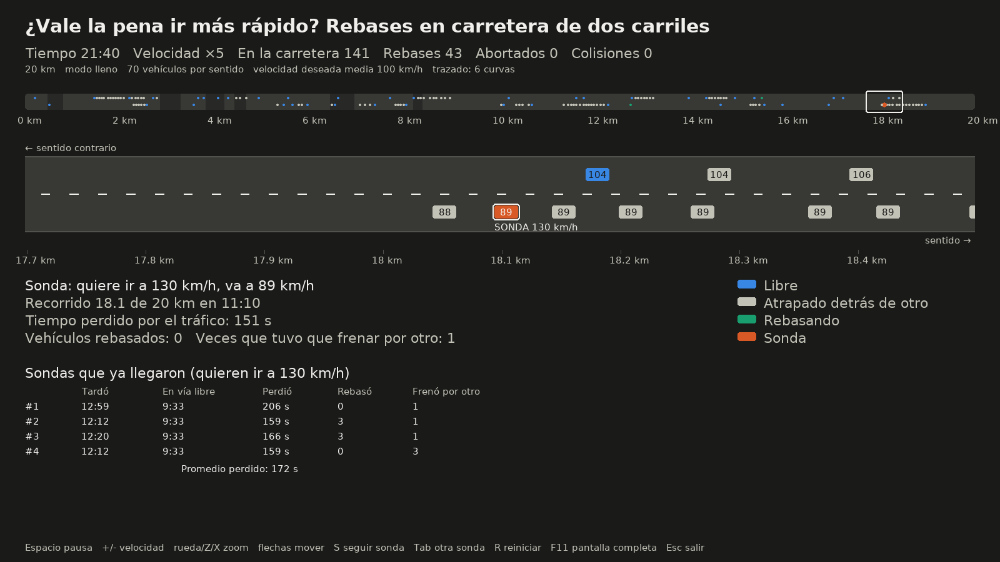

## Uso rápido

```bash
trafico                 # menú interactivo (recomendado)
trafico corrida ...     # una simulación con todos los datos y gráficas
trafico animar ...      # animación en vivo (para mostrar en una expo)
trafico campana ...     # muchas simulaciones barriendo parámetros
trafico graficar DIR    # gráficas de una campaña ya corrida
```

`python -m trafico ...` funciona igual. Cada comando acepta `-h` para ver todas sus opciones.

### Sitio web

`site/` es la página de GitHub Pages: la animación (`index.html`, `sim.js`, con el simulador de `src/trafico`
corriendo en un *Web Worker* con Pyodide) y el cartel de resultados (`resultados.html`). Se publica sola con
cada push (`.github/workflows/pages.yml`). Para probarla en tu PC: `bash scripts/sitio.sh --servir` y abre
<http://localhost:8000>. La primera vez tarda unos segundos en cargar Python y numpy.

### Menú

`trafico` sin argumentos abre un menú que pregunta paso a paso (Enter acepta el valor por defecto):
corrida única, animación, campaña o graficar. Al final muestra el **comando equivalente**, para poder
repetir exactamente la misma corrida.

### Tráfico: tres formas de definirlo

| Modo | Qué significa | Opciones |
|---|---|---|
| `flujo` | Llegan vehículos al azar (Poisson), tantos por hora y sentido | `--flujo 200` |
| `lleno` | La carretera arranca con N vehículos por sentido y cada uno que sale se repone | `--modo lleno --vehiculos 70` |
| `total` | Entran exactamente N vehículos por sentido y la corrida termina cuando salen todos | `--modo total --vehiculos 200 --flujo 300` |

Velocidades deseadas Normal(`--v-media` 100, `--sigma` 10) km/h truncada a 60-140.
Las **sondas** son vehículos con velocidad deseada fija (`--vel-sonda 130`) que entran a intervalos
regulares y se miden aparte.

### Tipo de carretera

| `--trazado` | Descripción |
|---|---|
| `recta` | Sin curvas (por defecto) |
| `pocas` | 0.3 curvas por km, radio 300-900 m |
| `muchas` | 1.2 curvas por km, radio 150-450 m |
| `montana` | 2.5 curvas por km, radio 60-200 m |

Los trazados se generan al azar: con `--semilla-trazado 0` (por defecto) cada réplica tiene una carretera
distinta del mismo tipo, y con otro número el trazado queda fijo. También se pueden dar curvas a mano
(por ejemplo, de una carretera real): `--param "curves=1500:2500:200;6000:6400:350"` (inicio:fin:radio en m).

### Corrida única

```bash
trafico corrida --flujo 200 --longitud 20000 --vel-sonda 130 --sondas 5 --trazado pocas --salida results/r1
```

Guarda en la carpeta de salida:

- `viajes.csv`: un renglón por vehículo, con su velocidad deseada, tiempo de viaje, tiempo libre, retraso,
  rebases hechos, veces que lo rebasaron, **alcances** (veces que tuvo que frenar por alguien), tiempo lento
  y espera para entrar; además headway, tiempo en el carril contrario, TTC, conflictos, litros, CO2 y choques
  (ver [docs/datos.md](docs/datos.md)).
- `eventos.csv`: cada rebase iniciado, completado o abortado (instante y posición).
- `fotos.csv`: posición y velocidad de todos los vehículos cada 5 s (`--fotos`).
- `config.json` (para repetirla) y `resumen.json`.
- Gráficas: diagrama espacio-tiempo, histograma de retrasos, retraso contra velocidad deseada,
  % de vehículos en pelotón y rebases por kilómetro.


### Animación

```bash
pip install -e ".[anim]"   # una vez (instala pygame-ce)
trafico animar --modo lleno --vehiculos 70 --trazado pocas --pantalla-completa
```

Arriba se ve la carretera completa y abajo un tramo ampliado que sigue a la sonda. Colores:
**azul** libre, **gris** atrapado detrás de otro, **verde** rebasando y **naranja** la sonda.
Las curvas aparecen sombreadas con su radio y velocidad máxima, y la línea central es amarilla
continua donde no hay visibilidad para rebasar. Abajo, una tabla muestra cuánto tardó cada sonda
y cuánto perdió por el tráfico.

Controles: `Espacio` pausa, `+`/`-` velocidad (×1 a ×100), rueda o `Z`/`X` zoom, flechas para moverse,
`S` seguir a la sonda, `Tab` otra sonda, clic en el mapa para ir a un punto, `R` reiniciar,
`F11` pantalla completa, `Esc` salir.

### Comportamiento realista (fases 3 y 4)

Todo esto viene **apagado por defecto** (así los resultados de las fases 1 y 2 se reproducen exactamente).
`--realista` lo enciende con valores razonables (desde la fase 4 incluye asomarse y la aceptación de hueco con
logit; los carriles de rebase no, porque son parte de la carretera), y cada pieza se puede ajustar o barrer por
separado:

| Qué | Cómo se activa | Qué hace |
|---|---|---|
| Camiones | `--camiones 0.15` | 16.5 m, aceleran 0.5 m/s². Velocidad deseada con moda en 105 km/h (96 % entre 90 y 110) y 2 % de casos raros: muy lentos (60-90) o con exceso (110-125). |
| Pendientes | `--relieve lomerio` / `montanoso`, o `--param "pendientes=1000:3000:6;..."` (%) | Física con potencia del motor y aire, calibrada con datos (ver abajo). En subida se pierde velocidad poco a poco; en bajada la gravedad empuja y se gana velocidad (autos hasta +10 %, camiones +5 %); los camiones muy cargados usan freno de motor solo en bajadas fuertes (>4 %) y largas (>2 km). |
| Cambio de carril gradual | `--param overtaking.t_lane_change=3` | Cambiar de carril tarda 3 s y mientras tanto ocupa los dos carriles. |
| Rebase en cadena | `--param overtaking.convoy=1` | Se puede seguir a otro que ya rebasa, si el rebase propio es seguro. |
| Visión tapada | `--param overtaking.blocked_view=1` | Regla fija (fase 3): detrás de un camión a menos de 3 s no se ve el carril contrario; detrás de un auto a menos de 2 s se ven 500 m. |
| Asomarse (fase 4) | `--param asomarse=1` | Reemplaza la regla fija por una línea de visión: el conductor se corre 0.6 m hacia la raya central y ve más cuanto más lejos va del de delante. Detrás de un auto ve todo; detrás de un camión a 20 m, ~107 m. |
| Aceptación de hueco con logit (fase 4) | `--param rebase_logit=1` | En lugar del margen fijo de 6 s, cada conductor acepta un hueco con una probabilidad que crece con el tiempo sobrante, con un rasgo propio (al estilo de Farah). Sin piso de seguridad (`piso_seguro=1` lo añade). |
| Carriles de rebase 2+1 (fase 4) | `--param cada_2mas1=5000` o `--param "carriles_rebase=2000:3500:1;..."` | Tramos en que un sentido tiene un segundo carril para rebasar sin tráfico de frente; incorporación obligada al final; el otro sentido no rebasa ahí. |
| Límites de velocidad | `--param limite=90` o `--param "limites=5000:8000:70"` | Se frena antes de la señal. Con `respetan_limite=0.8`, el 20 % se pasa entre 10 y 30 %. |
| Zonas de no rebase | `--param "zonas_no_rebase=2000:5000"` o `no_rebase_sin_visibilidad=1` | Quien respeta (`respetan_no_rebase`) no empieza un rebase que invada la zona. |
| Tipos de conductor | `--param prudentes=0.2 --param agresivos=0.15` | Prudentes: más margen, más distancia y más diferencia de velocidad para decidir rebasar. Agresivos: lo contrario. |
| Impaciencia | `--param impaciencia=60` | Tras 60 s atrapado, el margen que exige baja poco a poco hasta la mitad. |
| Tiempo de reacción | `--param reaccion=1.0` | Responde con 1 s de retraso, pero se anticipa como en el *Human Driver Model* (estima el hueco y mira a los 3 de delante). Los sustos y el frenado de emergencia son inmediatos. |

En la animación los camiones se ven más largos y con cabina, el cambio de carril se ve, hay un perfil de alturas
arriba, rótulos de "sube/baja x %" y señales circulares de límite de velocidad.

### Campañas

**Más rápido con PyPy**: `bash scripts/instalar_pypy.sh` (una vez) y añade `--rapido` a `trafico campana`. La
simulación corre con PyPy y las gráficas con el Python normal. Da exactamente los mismos resultados y es de 5 a
11 veces más rápido (20 km realista en montaña: 57 s → 5 s por corrida).

```bash
trafico campana --barrer trazado=recta,pocas,muchas --barrer flujo=100,200,300 \
    --semillas 8 --sondas 20 --nucleos 8 --rapido --salida results/curvas
trafico graficar results/curvas --mejor                  # la mejor velocidad, con costo en MXN
trafico graficar results/curvas --x flujo --serie trazado --comparar 120 130
```

Las sondas van por defecto de 90 a 150 km/h, de 10 en 10 (`--velocidades` para otras).

- Se puede barrer **cualquier parámetro** (`--barrer nombre=v1,v2,...`, repetible: se combinan todos). Nombres
  cortos: `flujo`, `longitud`, `vehiculos`, `modo`, `trazado`, `relieve`, `camiones`, `sigma`, `v_media`,
  `despeje`, `a_lateral`, `limite`, `prudentes`, `agresivos`, `impaciencia`, `reaccion`, o internos como `idm.T`,
  `overtaking.t_guard` y `overtaking.convoy`. `--realista` también vale para campañas.
- Cada corrida se guarda en cuanto termina: si se corta, el mismo comando **reanuda**. Con más `--semillas`
  o `--velocidades` se amplía una campaña existente sin repetir lo hecho.
- Datos crudos: `corridas.csv` (resumen del tráfico de fondo por corrida), `sondas.csv` (cada sonda) y
  `viajes.csv` (cada vehículo de cada corrida, para analizarlo después; `--sin-viajes` lo apaga). Qué es cada
  columna: [docs/datos.md](docs/datos.md).
- `graficar` genera tablas con media ± IC 95 % y gráficas sin volver a simular. Con `--mejor` pone en la balanza
  tiempo, combustible, CO2 y riesgo (ver abajo); `--precio valor_tiempo_h=150` cambia un precio sin volver a
  correr nada.
- `--trayectorias 1` guarda además la posición de cada vehículo cada segundo (tipo NGSIM, un archivo por
  corrida; `--solo-sondas` para solo las sondas). Son archivos grandes.

## Tutorial: de cero a "¿qué velocidad me conviene?"

Diez pasos con ejemplos que corren en segundos (carretera de 10 km, pocas réplicas). Para resultados serios,
usa 20 km y 8 semillas como en las campañas de abajo. Supone que ya instalaste el proyecto
([Instalación](#instalación-en-cualquier-pc)) y activaste el entorno (`source .venv/bin/activate`).

**1. Una corrida para ver qué sale.** Tres sondas que quieren ir a 130 km/h entre tráfico de 200 veh/h:

```bash
trafico corrida --longitud 10000 --flujo 200 --vel-sonda 130 --sondas 3 --salida results/tut_corrida
```

```
  vehículos que salieron: 117  retraso medio: 14.4 s  rebases: 20 (abortados 0)  colisiones: 0
  sondas a 130 km/h: tiempo 335 s, retraso 57.9 s, rebases 0.7, alcances 1.0
```

En `results/tut_corrida/` quedan `viajes.csv` (un renglón por vehículo, columnas en
[docs/datos.md](docs/datos.md)), `eventos.csv`, `fotos.csv` y gráficas como `espacio_tiempo.png`. La sonda
quería tardar 277 s (10 km a 130) y tardó 335: perdió 58 s detrás de otros.

**2. Verlo en movimiento** (opcional, necesita `pip install -e ".[anim]"`):

```bash
trafico animar --realista --param cada_2mas1=3000 --longitud 8000
```

Sin ventana, `--captura imagen.png --captura-en 400` guarda una imagen del segundo 400.

**3. Muchas corridas: una campaña.** Compara 100 y 300 veh/h, con sondas de 90 a 150 km/h (las velocidades
por defecto) y 4 réplicas:

```bash
trafico campana --longitud 10000 --barrer flujo=100,300 --semillas 4 --sondas 10 --nucleos 8 \
    --salida results/tut_campana        # añade --rapido si instalaste PyPy (scripts/instalar_pypy.sh)
```

Son 56 corridas (~30 s con 8 núcleos). Si se corta, el mismo comando la reanuda.

**4. La mejor velocidad.**

```bash
trafico graficar results/tut_campana --mejor
```

```
100 veh/h · precios medio: mejor 90 km/h (29.6 ± 0.0 MXN; no se distingue de 90-90 km/h)
300 veh/h · precios medio: mejor 90 km/h (29.4 ± 0.1 MXN; no se distingue de 90-150 km/h)
...
```

En `results/tut_campana/graficas/` revisa primero `mejor_ganancia.png` (cuánto se gana contra ir a 100),
`mejor_valor_equilibrio.png` (cuánto tendría que valer tu hora para que convenga ir más rápido) y
`mejor_partes__*.png` (de qué se compone el costo). Los números están en `mejor_por_velocidad.csv` y
`mejor_velocidad.csv`.

**5. ¿Y si mi tiempo vale más?** Los precios se aplican después de simular: cambiarlos no obliga a correr nada
otra vez.

```bash
trafico graficar results/tut_campana --mejor --precios medio --precio valor_tiempo_h=600
```

```
100 veh/h · precios medio: mejor 120 km/h (79.0 ± 0.1 MXN; no se distingue de 120-140 km/h)
300 veh/h · precios medio: mejor 150 km/h (83.6 ± 3.1 MXN; no se distingue de 130-150 km/h)
```

Precios que se pueden cambiar (`src/trafico/costos.py`): `valor_tiempo_h`, `gasolina_l`, `diesel_l`, `co2_t`,
`accidentes_vkm`, `v_ref_kmh` y `riesgo` (`nilsson` o `kloeden`).

**6. Comparar dos velocidades bien.** Como cada semilla da el mismo tráfico a todas las velocidades, la
diferencia se mide semilla por semilla:

```bash
python .claude/skills/analisis-trafico/scripts/comparar.py results/tut_campana --a 100 --b 130 --campos tiempo_viaje litros
```

```
combinación             campo              a        b − a    IC 95 %  ¿distinto de 0?
flow_per_hour=100.0     tiempo_viaje     364.575  -64.555     8.975  sí
flow_per_hour=100.0     litros             0.560    0.134     0.028  sí
flow_per_hour=300.0     tiempo_viaje     396.755  -13.075    20.399  no
```

A 100 veh/h, ir a 130 ahorra 65 ± 9 s y gasta 0.13 L más. A 300 veh/h, con 4 réplicas, la diferencia no se
distingue de cero: hacen falta más semillas (`--semillas 8` en el mismo comando de la campaña amplía la que
ya tienes).

**7. Explorar los viajes de todos los vehículos.** Resume cualquier columna de `viajes.csv` por grupos, con la
corrida como réplica:

```bash
python .claude/skills/analisis-trafico/scripts/resumir_viajes.py results/tut_campana --campo retraso \
    --por flow_per_hour --filtro sonda=0 viaje_completo=1 v_sonda=130
```

```
  100.0        8.012 ±  1.355   (4 corridas, 483 viajes)
  300.0       32.194 ±  6.993   (4 corridas, 1460 viajes)
```

Otras ideas: `--campo l_100km --por clase` (autos contra camiones), `--campo t_carril_contrario --por conductor`.

**8. "¿Qué pasa si...?": barrer cualquier parámetro.** Por ejemplo, ¿ayudan los carriles de rebase 2+1 en el
modelo realista?

```bash
trafico campana --realista --longitud 10000 --barrer cada_2mas1=0,3000 --velocidades 100 130 \
    --semillas 4 --sondas 10 --nucleos 8 --rapido --salida results/tut_2mas1
python .claude/skills/analisis-trafico/scripts/comparar.py results/tut_2mas1 --a 100 --b 130 --campos tiempo_viaje
```

```
passing_every=0.0        tiempo_viaje   388.820   -19.330   12.805  sí
passing_every=3000.0     tiempo_viaje   379.105   -29.885   12.263  sí
```

Con un tramo 2+1 cada 3 km, todos tardan menos (379 contra 389 s a 100 km/h) y querer ir a 130 rinde más (30
contra 19 s). Se puede barrer cualquier parámetro de la tabla del [comportamiento
realista](#comportamiento-realista-fases-3-y-4) (`camiones`, `relieve`, `trazado`, `reaccion`, `asomarse`,
`rebase_logit`...).

**9. Trayectorias segundo a segundo** (tipo NGSIM, para análisis propios):

```bash
trafico corrida --longitud 5000 --flujo 200 --sondas 2 --trayectorias 1 --solo-sondas --salida results/tut_tray
```

`trayectorias.csv` trae, cada segundo, la posición, el carril, la velocidad, la aceleración, quién va delante
y detrás, el hueco y el headway.

**10. Pedirle el análisis a Claude.** En este repo hay una skill, `analisis-trafico` (`.claude/skills/`), con las
reglas para no equivocarse con estos datos (la réplica es la semilla, comparar emparejando, eventos raros por
veh-km, separar lo simulado de lo supuesto) y para hacer las gráficas. En Claude Code basta con pedir, por
ejemplo: *"con results/f4_camiones_relieve, ¿cuánto tiempo pierden los autos detrás de camiones en montaña y
cuánto cambia con la velocidad deseada?"*. Para consultas SQL rápidas sobre los CSV grandes se puede instalar
además `duckdb-skills` (`/plugin marketplace add duckdb/duckdb-skills` y
`/plugin install duckdb-skills@duckdb-skills`).

## Resultados fase 4: ¿qué velocidad conviene?

La pregunta ya no es solo "120 o 130". Ahora se compara toda la gama de velocidades deseadas, de **90 a 150 km/h**
de 10 en 10, poniendo en la balanza **el tiempo que se gana** contra **el combustible, el CO2 y el riesgo**.
Se corrieron otra vez las campañas de las fases 1 a 3, más dos nuevas del rebase calibrado y de carriles 2+1:
3,248 corridas de 20 km (salvo la de distancia), 8 réplicas, 20 sondas por corrida y los viajes de todos los
vehículos guardados (`scripts/campanas_fase4.sh`, ~1 h con 15 núcleos y PyPy). Tablas completas en
`docs/f4_*_resumen.csv` y `docs/f4_*_mejor_*.csv`.

### 1. La más rápida siempre llega antes, pero cada paso gana menos (recta de 20 km, modelo simple)

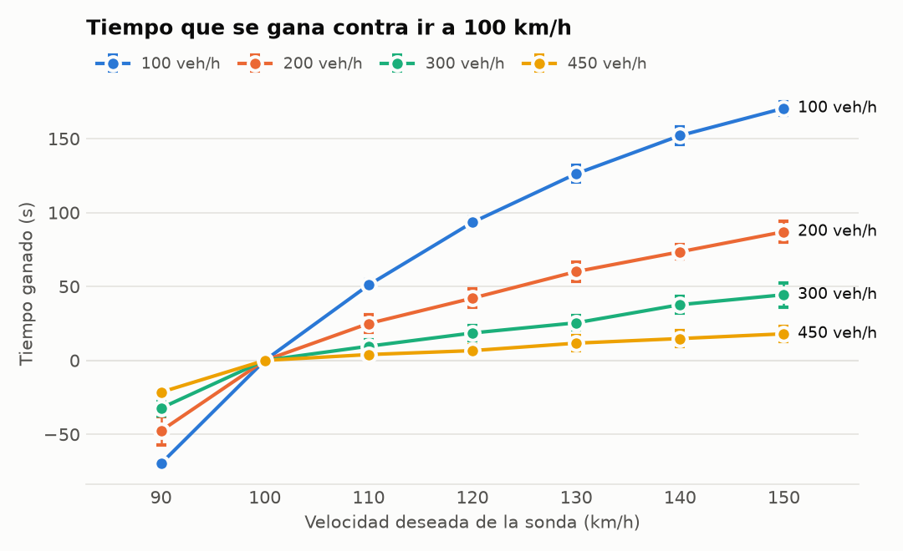

Tiempo de viaje de la sonda a 200 veh/h por sentido: 815, 767, 742, 725, 707, 694 y 680 s a 90, 100, …, 150
km/h. Cada paso de +10 km/h ahorra 48, 25, 17, 18, 13 y 14 s: después de 110 el tráfico se come casi todo.

| Flujo por sentido | 100 → 120 | 100 → 130 | 100 → 150 | Velocidad media real queriendo ir a 130 |
|---:|---:|---:|---:|---:|
| Vía libre (ideal) | 120 s | 166 s | 240 s | 130 km/h |
| 100 veh/h | 93 ± 4 s | 126 ± 6 s | 171 ± 5 s | 119 km/h |
| 200 veh/h | 42 ± 6 s | 60 ± 7 s | 87 ± 7 s | 102 km/h |
| 300 veh/h | 19 ± 5 s | 25 ± 5 s | 44 ± 8 s | 94 km/h |
| 450 veh/h | 7 ± 4 s | 12 ± 5 s | 18 ± 5 s | 89 km/h |

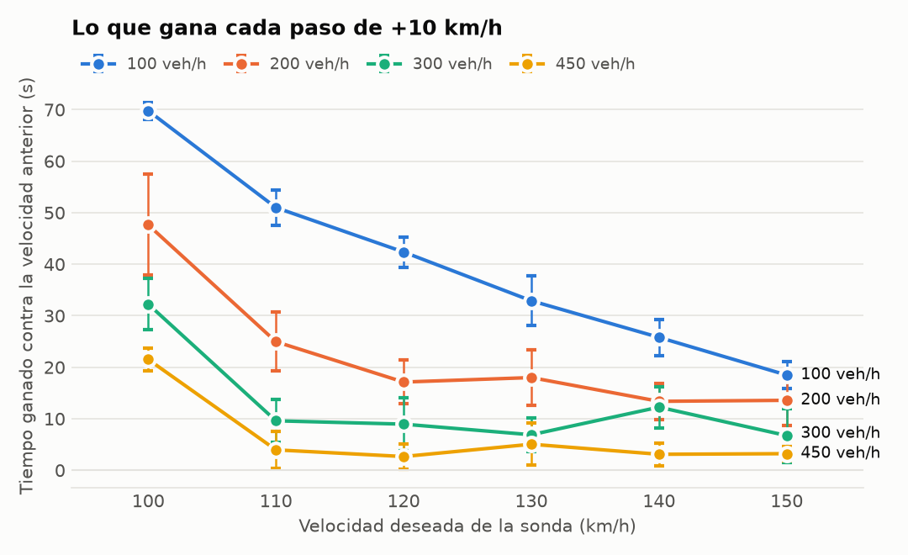

### 2. Lo que cuesta ir más rápido (200 veh/h, recta)

| Velocidad deseada | 90 | 100 | 110 | 120 | 130 | 140 | 150 |
|---|---:|---:|---:|---:|---:|---:|---:|
| Tiempo de viaje (s) | 815 | 767 | 742 | 725 | 707 | 694 | 680 |
| Combustible (L/100 km) | 5.1 | 5.4 | 5.6 | 5.7 | 6.0 | 6.2 | 6.5 |
| Riesgo de muertos, modelo potencia (× a 100 km/h de media) | 0.60 | 0.78 | 0.90 | 0.99 | 1.10 | 1.20 | 1.30 |
| Riesgo individual de Kloeden (× ir con el tráfico) | 0.72 | 1.03 | 1.32 | 1.58 | 1.98 | 2.38 | 2.87 |
| Tiempo en el carril contrario (s por viaje) | 4 | 10 | 19 | 30 | 41 | 49 | 56 |

- **Las tres medidas de riesgo suben**, y no se mezclan entre sí. El modelo potencia usa la velocidad media del
  viaje (que sube poco: de 88 a 107 km/h). La de Kloeden mide cuánto se aleja uno del tráfico de fondo (que va a
  ~95 km/h). La del simulador es lo que la sonda pasa en el carril contrario: de 4 s a casi 1 minuto por viaje.
- En el modelo realista, el **8 % de las sondas a 140-150 km/h tuvo que frenar de emergencia**, contra 0 % a
  100 km/h.

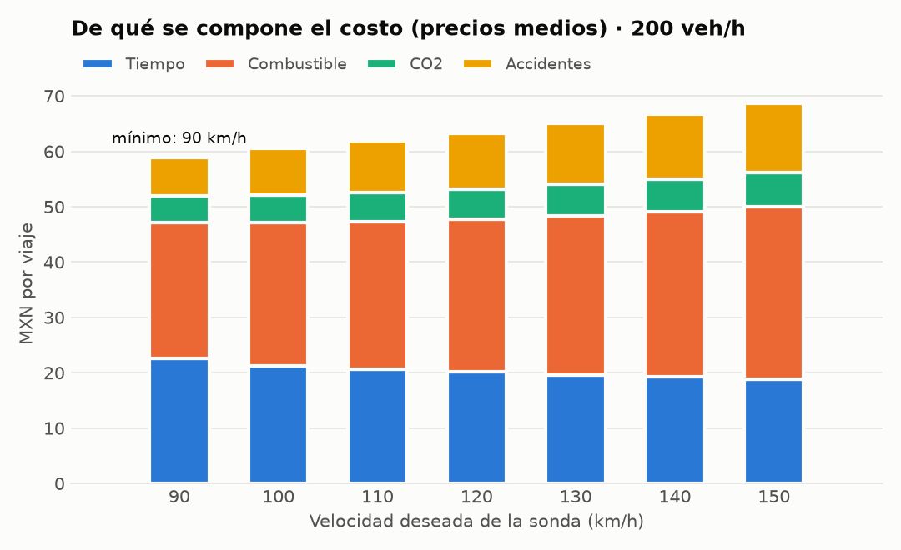

### 3. La mejor velocidad depende de cuánto vale tu tiempo

El costo de cada viaje en MXN = tiempo × valor del tiempo + combustible + CO2 + accidentes esperados. Los precios
son **supuestos** (tres escenarios, ver [docs/datos.md](docs/datos.md)). Con los tres escenarios, y en casi
todas las carreteras, **la velocidad de menor costo es 90 km/h**. El tiempo que se gana no paga el combustible y,
sobre todo, el riesgo extra.

Como los precios son lo más incierto, la medida más útil es la inversa: **¿cuánto tendría que valer una hora (por
vehículo) para que ir más rápido salga a cuenta?**

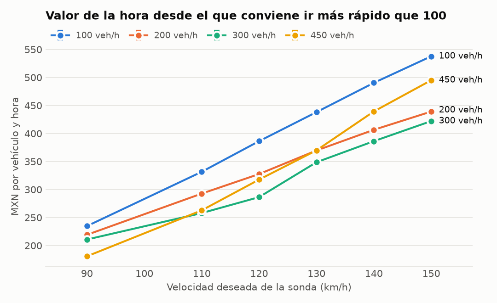

| Carretera (20 km) | Gana 100 → 130 | Conviene ir a 130 y no a 100 si tu hora vale más de… | …contando solo combustible y CO2 | Mejor velocidad (precios medios) |
|---|---:|---:|---:|---:|
| Recta, 100 veh/h | 126 s | 438 MXN | 214 MXN | 90 |
| Recta, 200 veh/h | 60 s | 370 MXN | 211 MXN | 90 |
| Recta, 300 veh/h | 25 s | 349 MXN | 223 MXN | 90 |
| Pocas curvas, 200 veh/h | 46 s | 365 MXN | 221 MXN | 90 |
| Muchas curvas, 200 veh/h | 9 s | 614 MXN | 532 MXN | 90 |
| Montaña, 200 veh/h | 2 s | 535 MXN | 518 MXN | 90 |
| 40 km de recta, 200 veh/h | 140 s | 373 MXN | 226 MXN | 90 |
| Realista, recta, 200 veh/h | 50 s | 361 MXN | 198 MXN | 90 |
| Realista, montañoso, 10 % camiones | 27 s | 210 MXN | 75 MXN | **110** (90-120) |
| Realista, montañoso, 25 % camiones | 11 s | 202 MXN | 108 MXN | **110** (100-150) |
| Realista con 2+1 cada 5 km, 350 veh/h | 30 s | 400 MXN | 270 MXN | 90 |

(Entre paréntesis: velocidades cuyo costo no se distingue del mínimo, con la diferencia emparejada por semilla.)

**Conclusiones**
- **Llega antes el que va más rápido, siempre**, pero el ahorro se agota: en una recta con tráfico moderado
  (200 veh/h), pasar de 100 a 130 ahorra 1 minuto en 20 km, y de 130 a 150, 27 s más.
- **Ir a 130 en lugar de 100 solo conviene si tu hora vale más de ~350-450 MXN** (en recta). Aun sin contar
  accidentes, el combustible y el CO2 de más ya piden ~200 MXN por hora. Con los precios medios supuestos (100
  MXN por vehículo y hora) conviene ir a 90-100.
- **Con curvas o montaña, ir rápido casi no ahorra tiempo** (de 2 a 9 s) y aun así gasta más, por acelerar y
  frenar entre curvas: el valor de equilibrio sube a ~480-680 MXN por hora.
- **La excepción es la montaña con camiones** (modelo realista): ahí todos van detrás de los camiones en las
  subidas, la velocidad real casi no cambia y el riesgo tampoco, así que querer ir un poco más rápido (110) gana
  algunos segundos casi gratis. Con 25 % de camiones, ir a 100 sale incluso más barato que ir a 90, aun sin
  valorar el tiempo (por eso el valor de equilibrio en 90 es negativo).

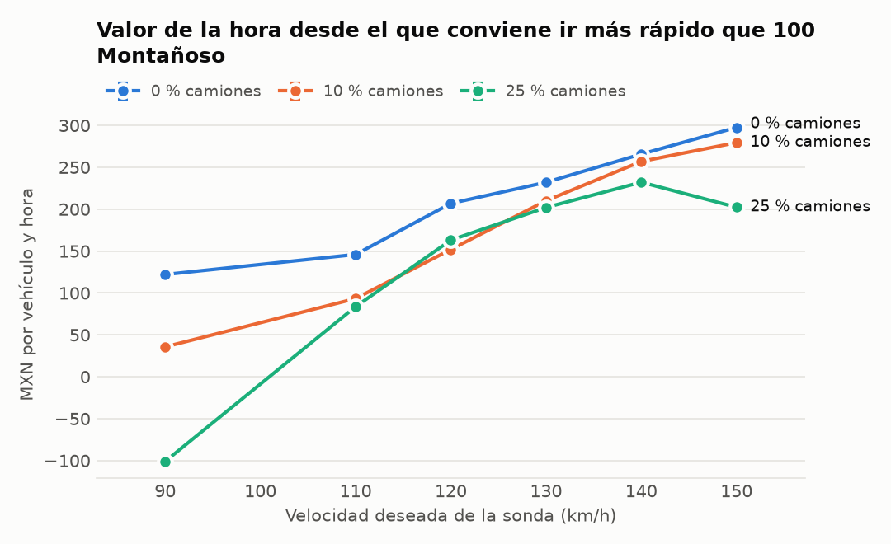

### 4. Rebase calibrado y carriles 2+1 (modelo realista, 200 veh/h)

| Modelo de rebase | Gana 100 → 130 | Velocidad media a 130 |
|---|---:|---:|
| Criterio fijo y vista tapada fija (fase 3) | 13 ± 10 s | 94 km/h |
| Criterio fijo y **se asoma** | 44 ± 10 s | 101 km/h |
| **Logit** y vista tapada fija | 13 ± 11 s | 94 km/h |
| Logit y se asoma (el realista de ahora) | 50 ± 11 s | 102 km/h |

- **Asomarse es lo que más cambia el resultado**: con la regla fija de la fase 3, detrás de un auto a menos de 2 s
  solo se veían 500 m del carril contrario. Con la línea de visión, quien se asoma ve todo detrás de un auto (no
  así detrás de un camión), rebasa más y la ganancia de ir rápido se multiplica por más de tres.
- **El logit** (aceptar huecos con una probabilidad, distinta para cada conductor) sube un poco los rebases, pero
  trae sustos: de 2 a 11 vehículos por corrida frenan de emergencia, casi siempre el que viene de frente cuando
  alguien rebasó con un hueco justo. En 13.5 millones de veh-km del modelo realista hubo **3 choques, todos con el
  logit** (unos 0.2 por millón de veh-km). Con el criterio fijo, 0.
- **Carriles de rebase 2+1** (un tramo de 1.5 km cada 5 km, alternando el sentido): a 350 veh/h la ganancia de ir
  a 130 pasa de 21 ± 10 a 30 ± 6 s y la de 150, de 25 a 38 s. Sobre todo mejora para todos: los rebases por
  vehículo pasan de 0.36 a 0.76 y el retraso medio del tráfico de fondo baja de 87 a 76 s (de 53 a 46 s a
  200 veh/h). Es una mejora de la carretera más que de la velocidad.

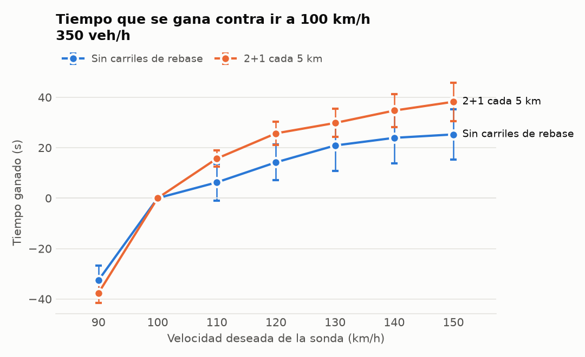

**Ojo con los supuestos.** El costo de los accidentes por veh-km, los exponentes del modelo potencia (de estudios
de flujos, no de un vehículo), la curva de Kloeden (medida en Australia, entre −10 y +30 km/h de diferencia), los
coeficientes del logit y del consumo son supuestos razonables pero **no están calibrados para México**. Se pueden
cambiar sin volver a simular: `trafico graficar results/f4_flujo --mejor --precio valor_tiempo_h=250`. Lo robusto
es la forma: la más rápida llega antes con ganancias cada vez menores, y el combustible y el riesgo suben más
rápido que el tiempo que se gana.

## Anexo: 120 contra 130 km/h (fases 1 a 3)

Resultados de las fases anteriores, que comparaban solo 120 y 130 km/h. Los de la fase 3 son del modelo realista
**antes** de asomarse y del logit (con la vista tapada fija); con el realista de ahora la ganancia es mayor (ver
arriba).

### Fase 3: modelo realista (20 km, 8 réplicas)

Con `--realista` se suman camiones, cambio de carril de 3 s, rebase en cadena, visión tapada, conductores
distintos con impaciencia y 1 s de reacción. En las 352 corridas de estas campañas hubo **0 colisiones**.

#### ¿Qué pieza pesa más? (recta, 200 veh/h, ganancia 120 → 130 km/h)

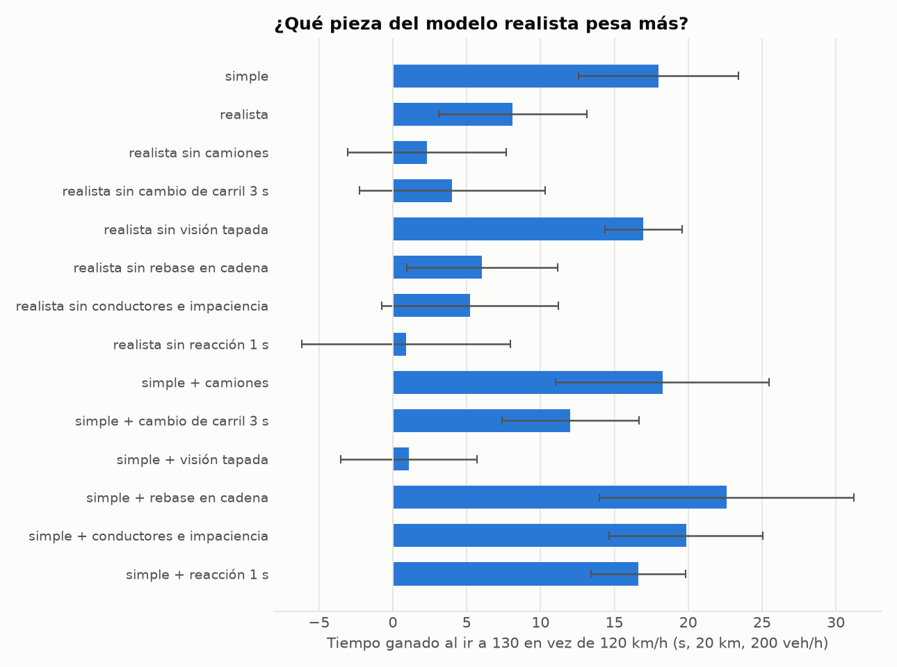

| Variante | Ganancia |
|---|---:|
| Modelo simple | 18.0 ± 5.4 s |
| Modelo realista | 8.1 ± 5.0 s |
| Realista **sin visión tapada** | 17.0 ± 2.6 s |
| Simple **+ solo visión tapada** | 1.1 ± 4.6 s |
| Simple + solo cambio de carril de 3 s | 12.0 ± 4.6 s |
| Simple + solo camiones / conductores / reacción / cadena | 17 a 23 s (sin diferencia clara) |

**La visión tapada es la que manda.** Si quien va pegado a otro vehículo no ve lo suficiente del carril
contrario, casi nunca encuentra cuándo rebasar, y la ventaja de ir más rápido desaparece. El cambio de carril
lento le quita una parte (los rebases necesitan más espacio). Las demás piezas mueven el resultado menos que el
margen de error. **Ojo:** la visión tapada usa supuestos sin calibrar (detrás de un camión a menos de 3 s no se
ve nada; detrás de un auto a menos de 2 s se ven 500 m), y en la realidad los conductores se abren un poco para
asomarse. Es el parámetro que más conviene medir con datos reales.
Tabla completa en `docs/descomposicion_realista.csv` (`python scripts/descomponer_realista.py`).

#### Camiones y pendientes (modelo realista, 200 veh/h)

Retraso medio de cada vehículo en 20 km:

| Camiones | Plano | Lomerío | Montañoso |
|---:|---:|---:|---:|
| 0 % | 66 s | 68 s | 66 s |
| 10 % | 69 s | 96 s | **178 s** |
| 25 % | 77 s | 126 s | **251 s** |


- **En plano los camiones casi no estorban**: el típico va a ~104 km/h, más rápido que el auto promedio.
- **En pendiente sí**: en montaña con 10 % de camiones, cada vehículo pierde en promedio 3 minutos en 20 km.
  En las subidas los camiones pesados se quedan atrás y se forman pelotones que, con tráfico de frente y
  visibilidad limitada, casi no pueden rebasar. En las bajadas recuperan velocidad.
- Sin camiones, el relieve casi no cambia nada: los autos apenas lo notan.
- La ganancia de ir a 130 en vez de 120 sigue siendo pequeña (de −3 a 10 s en 20 km, con intervalos de ±2 a
  ±9 s): estar atrás de un camión en subida cuesta casi lo mismo vayas a la velocidad que vayas. Con relieve,
  además, la ganancia ideal baja de 46 a ~34 s porque en las subidas fuertes un auto no sostiene 130.

#### Rebase en cadena (modelo realista, recta)

| Flujo | Uno a uno | En cadena |
|---:|---:|---:|
| 200 veh/h | 6.0 ± 5.1 s | 8.1 ± 5.0 s |
| 350 veh/h | 1.9 ± 1.5 s | 2.8 ± 2.3 s |

Dejar que se vayan varios a la vez ayuda un poco, pero la diferencia no es concluyente. Con visión tapada, el
segundo de la fila pocas veces ve lo suficiente para seguir al primero: el 8 % de los rebases fueron en cadena
a 200 veh/h y el 19 % a 350 veh/h (con más tráfico hay más filas largas esperando el mismo hueco).

#### Sustos

En el modelo realista aparecen algunos frenados de emergencia sin choque: de 0.2 a 0.5 por corrida en promedio
(0.15 en plano, 0.5 en lomerío, 0.8 en montaña; 0 con muchas curvas, porque casi no se rebasa). Casi siempre es
alguien que termina un rebase largo y, al volver a su carril, el que viene de frente tiene que frenar: casos
realistas de "se metió justo". En el modelo simple no hay.

### Fase 2: tipo de carretera y distancia

#### ¿Y si la carretera tiene curvas? (20 km, 8 réplicas, cada una con un trazado distinto)

Tiempo que se gana al ir a 130 en vez de 120 km/h (media ± IC 95 %; entre paréntesis, lo que se ganaría en vía libre):

| Flujo por sentido | Recta | Pocas curvas | Muchas curvas | Montaña |
|---:|---:|---:|---:|---:|
| 100 veh/h | 32.9 ± 4.8 s (46.2) | 26.1 ± 6.8 s (38.0) | 4.4 ± 1.8 s (7.1) | 0.3 ± 0.1 s (0.3) |
| 200 veh/h | 18.0 ± 5.4 s | 12.3 ± 3.6 s | 1.5 ± 1.2 s | 0.2 ± 0.1 s |
| 300 veh/h | 6.9 ± 3.3 s | 6.2 ± 3.8 s | 0.5 ± 0.5 s | 0.2 ± 0.1 s |
| % de la carretera sin visibilidad para rebasar | 0 % | 19 % | 68 % | 93 % |


**Conclusiones**
- **Las curvas quitan la ganancia por dos lados.** Primero, bajan el techo: con muchas curvas casi nunca se llega
  a 120 km/h entre una y otra, así que incluso en vía libre ir a 130 solo ahorra 7 s en 20 km (0.3 s en montaña).
  Segundo, quitan los rebases: a 200 veh/h cada vehículo rebasa en promedio 0.48 veces en recta, 0.32 con pocas
  curvas, 0.01 con muchas y nunca en montaña.
- Con **pocas curvas** suaves la carretera se parece a la recta: se pierde algo de ganancia (12 s frente a 18 s a
  200 veh/h), pero sigue valiendo la pena en tráfico ligero.
- Con **muchas curvas**, ir a 130 en lugar de 120 ahorra 1 o 2 segundos en 20 km: no compensa el riesgo.
- Curioso: con muchas curvas el **tráfico de fondo pierde menos tiempo** (28 s de retraso medio a 200 veh/h,
  frente a 48 s en recta). En las curvas todos van a la misma velocidad, así que importa menos que unos
  quieran ir más rápido que otros.

#### ¿Importa la distancia? (carretera recta, 8 réplicas)

| Longitud | 100 veh/h | 200 veh/h | 300 veh/h | Ideal |
|---:|---:|---:|---:|---:|
| 5 km | 7.6 ± 1.1 s | 2.6 ± 1.1 s | 1.3 ± 0.6 s | 11.5 s |
| 10 km | 16.4 ± 2.3 s | 7.7 ± 2.1 s | 3.9 ± 3.5 s | 23.1 s |
| 20 km | 32.9 ± 4.8 s | 18.0 ± 5.4 s | 6.9 ± 3.3 s | 46.2 s |
| 40 km | 66.8 ± 7.9 s | 47.4 ± 5.5 s | 23.0 ± 14.5 s | 92.3 s |

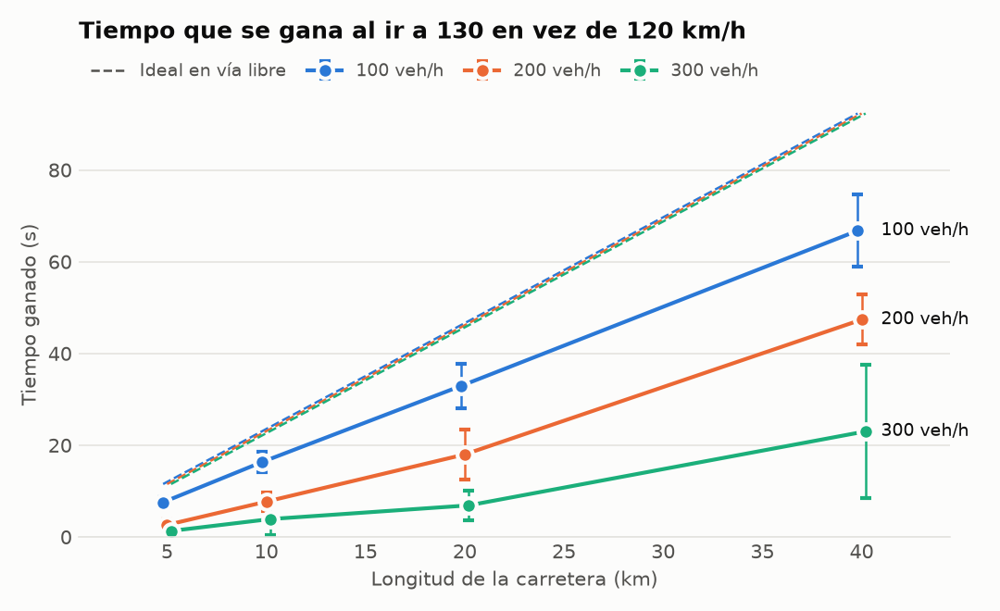
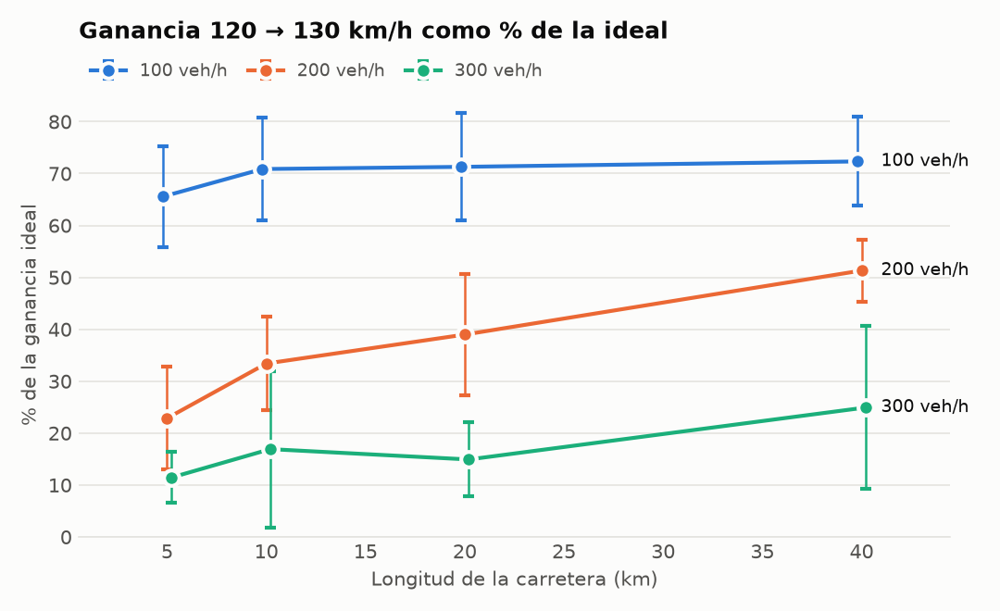

**Conclusiones**
- Con tráfico ligero (100 veh/h) se obtiene ~70 % de la ganancia ideal sin importar la distancia.
- Con tráfico moderado (200 veh/h), **en trayectos largos se aprovecha mejor ir rápido**: 23 % de la ganancia
  ideal en 5 km, 39 % en 20 km y 51 % en 40 km. Probablemente porque quedar atrapado detrás de un lento cuesta
  un tiempo parecido en cualquier trayecto, y en uno largo se reparte entre más kilómetros.
- En recorridos cortos con tráfico, ir a 130 en vez de 120 ahorra menos de 10 s.

Tablas completas en `docs/ganancia_trazado.csv` y `docs/ganancia_distancia.csv`.
En las 480 corridas de la fase 2 hubo 0 colisiones (2 vehículos usaron el frenado de emergencia).

### Fase 1: carretera recta de 20 km (8 réplicas)

Tiempo que se gana al ir a 130 km/h en lugar de 120 km/h (media ± IC 95 %):

| Flujo por sentido | Tiempo ganado | Ideal en vía libre |
|---:|---:|---:|
| 100 veh/h | 32.9 ± 4.8 s | 46.2 s |
| 200 veh/h | 18.0 ± 5.4 s | 46.2 s |
| 300 veh/h | 6.9 ± 3.3 s | 46.2 s |
| 450 veh/h | 5.1 ± 4.1 s | 46.2 s |

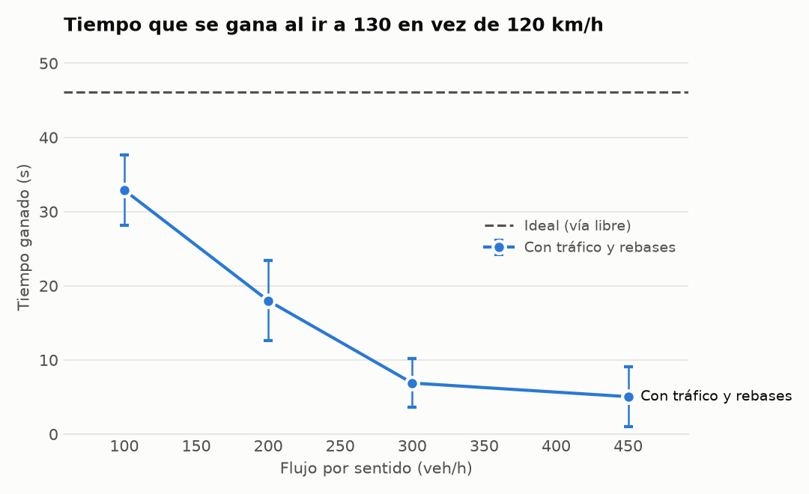

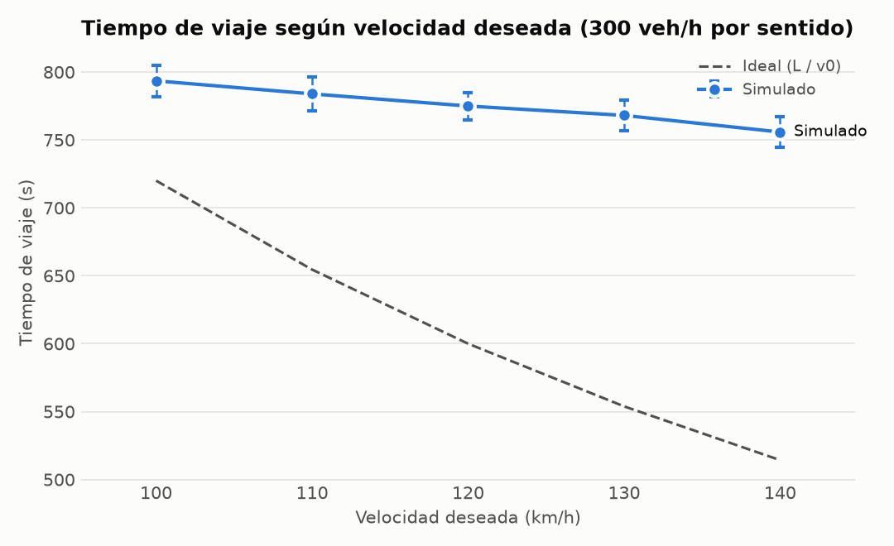

**Conclusiones**
- En vía libre, 130 en vez de 120 ahorra 46 s en 20 km. Con tráfico moderado (200 veh/h por sentido) se ahorran
  unos 18 s, y con 300 veh/h o más, menos de 10 s.
- Quien va más rápido acumula más retraso respecto a su ideal: a 130 se pierde más tiempo que a 120 porque
  alcanza a más vehículos.
- **Sin poder rebasar, la ventaja desaparece** (0.1 s a 200 veh/h): quedas atrapado detrás del más lento.
  Todo el beneficio de ir más rápido viene de los rebases.

#### Sensibilidad (200 veh/h por sentido, 6 réplicas)

Ganancia 120 → 130 km/h según el parámetro modificado (ver `docs/sensibilidad.csv`):

| Variante | Ganancia |
|---|---:|
| Base | 18.1 ± 8.0 s |
| Sin rebases | 0.1 s |
| Margen con el contrario 3 s / 10 s (base 6 s) | 19.8 / 16.2 s |
| Solo rebasa si el líder va ≥ 5 m/s más lento | 29.2 s |
| Decide cada 3 s (base 1 s) | 16.0 s |
| Intervalo IDM T = 1.0 s / 2.0 s (base 1.5 s) | 17.5 / 12.0 s |
| Aceleración máxima 1.5 m/s² (base 1.0) | 24.2 s |
| Dispersión de velocidades σ = 15 km/h (base 10) | 6.6 s |

Los intervalos de confianza son anchos (±4 a ±9 s), así que las diferencias pequeñas entre variantes no son
concluyentes. Lo robusto: el orden de magnitud, que la ganancia baja con el flujo y que sin rebases no hay ganancia.
La dispersión de velocidades, el umbral para rebasar y la aceleración son los parámetros que más mueven el resultado.


## Cómo funciona

- **Seguimiento**: modelo IDM (Intelligent Driver Model). Con vía libre el vehículo converge a su velocidad deseada.
- **Rebase**: máquina de estados `SIGUIENDO → REBASANDO → REGRESANDO`. Solo se inicia si, con estimaciones
  pesimistas para todos los demás, el rebase termina al menos 6 s antes de que llegue cualquier vehículo contrario.
  Puede rebasar pelotones de hasta 4 vehículos y abortar si aparece una amenaza. Hay frenado de emergencia como
  red de seguridad. El cambio de carril es instantáneo.
- **Curvas**: en una curva de radio R nadie va a más de √(a_lat·R), con a_lat = 2 m/s² (R = 150 m → 62 km/h;
  R = 400 m → 102 km/h). Se frena antes de entrar (1 m/s²).
- **Visibilidad**: dentro de una curva se ve √(8·R·m) metros del carril contrario, con un despeje lateral
  m = 10 m (R = 300 m → 155 m). Para rebasar, el conductor supone que justo donde se le acaba la visibilidad
  viene un coche de frente a 108 km/h; si la maniobra no cabe, no rebasa. En recta no cambia nada.
- **Pendientes** (solo con relieve, y siempre para camiones): la aceleración no puede pasar de lo que da el
  motor, P/v − g·(i + 0.01) − k·v², con P la potencia en la rueda y k el arrastre del aire. Cada camión sortea su
  relación peso/potencia: mediana 150 lb/hp (unos 9 W/kg en la rueda), calibrada con NCHRP 505 (carreteras de
  dos carriles), más un 15 % de "fulles" muy cargados (330-410 lb/hp, como el vehículo de proyecto de la SCT:
  75.5 t y 430 hp). Así, en una subida de 6 % un camión típico baja poco a poco hasta ~46 km/h (uno ligero
  ~67, un full ~23), y en 500 m de subida todavía va arriba de 70 km/h. Los autos (22 W/kg) casi no lo notan
  hasta 4 %. En bajada, la gravedad empuja y el conductor se deja llevar hasta +10 % (autos) o +5 % (camiones,
  dato de la SCT) de su velocidad deseada, así que se llega "con vuelo" a la siguiente subida. Los camiones muy
  cargados usan freno de motor en bajadas de más de 4 % y más de 2 km: V = 0.9/G m/s (regla de St John:
  65 km/h en 5 %, 46 en 7 %).
  Fuentes: NCHRP Report 505 (TRB, 2003); FHWA-RD-99-171 (TWOPAS); SCT, *Manual de Proyecto Geométrico de
  Carreteras* (2018); Bester y Oncke (2013). El preset montañoso usa tramos de 3 a 6 % (a veces 7 %) de 300 a
  800 m, dentro de las pendientes máximas de la SCT para terreno montañoso.
- **Experimento**: vehículos *sonda* con velocidad deseada fija entran a intervalos regulares tras un periodo de
  calentamiento. Se usan **números aleatorios comunes**: la misma semilla da el mismo tráfico de fondo (y la
  misma carretera) y las mismas horas de entrada, y solo cambia la velocidad de la sonda. Así la diferencia
  entre velocidades se mide sonda con sonda (emparejada) y no se pierde en el ruido.
- **Combustible y CO2** (solo se registran): en cada paso, la potencia en la rueda (VSP de Jiménez-Palacios, con
  la aceleración y la pendiente) y el consumo con una línea de Willans (ralentí + potencia / eficiencia), con
  coeficientes de auto de gasolina y de tractocamión diésel. Un auto en llano gasta 5.7, 6.8 y 7.5 L/100 km a
  100, 120 y 130 km/h. CO2 de la EPA. Detalle en [docs/datos.md](docs/datos.md).
- **Riesgo**, con tres medidas que no se mezclan: el modelo potencia (Nilsson; exponentes rurales de Elvik:
  muertos ∝ v^4.1), la curva individual de Kloeden (según cuánto se aleja uno de la velocidad del tráfico) y lo
  que mide el propio simulador (TTC, conflictos, sustos, choques).
- **Costo en MXN** de cada viaje = tiempo × valor del tiempo + combustible + CO2 + accidentes esperados, con
  precios bajo / medio / alto que son supuestos y se pueden cambiar (`src/trafico/costos.py`).
- **Retraso** = tiempo de viaje − tiempo en vía libre. Con curvas, el tiempo libre es el de un vehículo solo
  por esa misma carretera (frenando en las curvas), así que el retraso mide solo lo que cuesta el tráfico.

## Supuestos y límites

Sin intersecciones ni clima; los conductores no cambian su velocidad deseada durante el viaje; las curvas se
modelan por su radio y la visibilidad con un despeje lateral fijo; las crestas de las lomas no tapan la vista
(solo las curvas y los vehículos de delante); hay carriles de rebase 2+1 pero no carriles de ascenso sobre
el acotamiento; después de un choque los vehículos siguen (no se modela el accidente ni el cierre de la vía). En el modelo simple
(por defecto) todos los vehículos son autos iguales salvo la velocidad deseada, el cambio de carril es
instantáneo y no hay pendientes ni señales; `--realista` añade camiones, conductores distintos, cambio de carril
lento, rebase en cadena, tiempo de reacción, asomarse y aceptación de hueco con logit. Los coeficientes del logit,
del consumo y los precios son supuestos documentados en [docs/datos.md](docs/datos.md). Los parámetros no están calibrados con datos reales, así que los
resultados son cualitativos. El siguiente paso es importar trazados reales (GPX/OpenStreetMap, con curvas y
pendientes) y calibrar con aforos y velocidades medidas.

## Instalación (en cualquier PC)

```bash
git clone git@github.com:SFBlackMambo/<repo>.git
cd <repo>
python3 -m venv .venv
source .venv/bin/activate
pip install -e ".[dev,anim]"
pytest
```

En Ubuntu/WSL con Python 3.14 puede hacer falta `sudo apt install python3.14-venv` antes de crear el venv.
Para la animación se usa `pygame-ce` (el `pygame` clásico aún no tiene versión para Python 3.14).

## Reproducir los resultados

```bash
# Resultados de la fase 1 (recta, 20 km)
python scripts/run_experiment.py --flows 100 200 300 450 --seeds 8 --workers 8 --probes 20 --out results/main
python scripts/sensitivity.py --flow 200 --seeds 6 --workers 8
# Fase 2: tipo de carretera y distancia
trafico campana --barrer trazado=recta,pocas,muchas,montana --barrer flujo=100,200,300 \
    --velocidades 110 120 130 --semillas 8 --sondas 20 --nucleos 15 --salida results/curvas
trafico campana --barrer longitud=5000,10000,20000,40000 --barrer flujo=100,200,300 \
    --velocidades 120 130 --semillas 8 --sondas 20 --nucleos 15 --salida results/distancia
```

Las campañas de la fase 2 tardan unos 12 minutos con 15 núcleos (unas 5 veces menos con `--rapido`). Todo se guarda en `results/` (ignorada por git).

```bash
# Fase 4: la mejor velocidad (todas las campañas otra vez, de 90 a 150 km/h, y las del rebase calibrado)
bash scripts/campanas_fase4.sh
python scripts/resumen_fase4.py --docs docs
```

Las campañas de las fases 1 a 3 (resultados del anexo):

```bash
# Fase 3: modelo realista
trafico campana --realista --barrer camiones=0,0.1,0.25 --barrer relieve=plano,lomerio,montanoso --flujo 200 \
    --velocidades 120 130 --semillas 8 --sondas 20 --nucleos 15 --salida results/f3_camiones_relieve
trafico campana --realista --barrer flujo=100,200,300 --barrer trazado=recta,pocas,muchas \
    --velocidades 120 130 --semillas 8 --sondas 20 --nucleos 15 --salida results/f3_realista
trafico campana --realista --barrer overtaking.convoy=0,1 --barrer flujo=200,350 \
    --velocidades 120 130 --semillas 8 --sondas 20 --nucleos 15 --salida results/f3_cadena
```

## Estructura

```
src/trafico/  vehicle, fleet (camiones), drivers (conductores), idm (IDM y HDM), road, arrivals,
              overtaking, geometry (curvas, visibilidad, pendientes, señales), slopes, simulation,
              recorder, single, campaign, analysis, plots, plots_explore, animation, menu, cli, config,
              fuel (combustible y CO2), costos (riesgo y precios), mejor (la mejor velocidad)
tests/        pruebas con pytest
scripts/      run_experiment.py, sensitivity.py (fase 1), campanas_fase4.sh, resumen_fase4.py (fase 4),
              sitio.sh (arma el sitio web)
site/         página web: simulación en el navegador y cartel de resultados
docs/         gráficas y tablas de resultados
```

El plan y el seguimiento están en `EPCC_PLAN.md`, `epcc-features.json` y `epcc-progress.md`.
